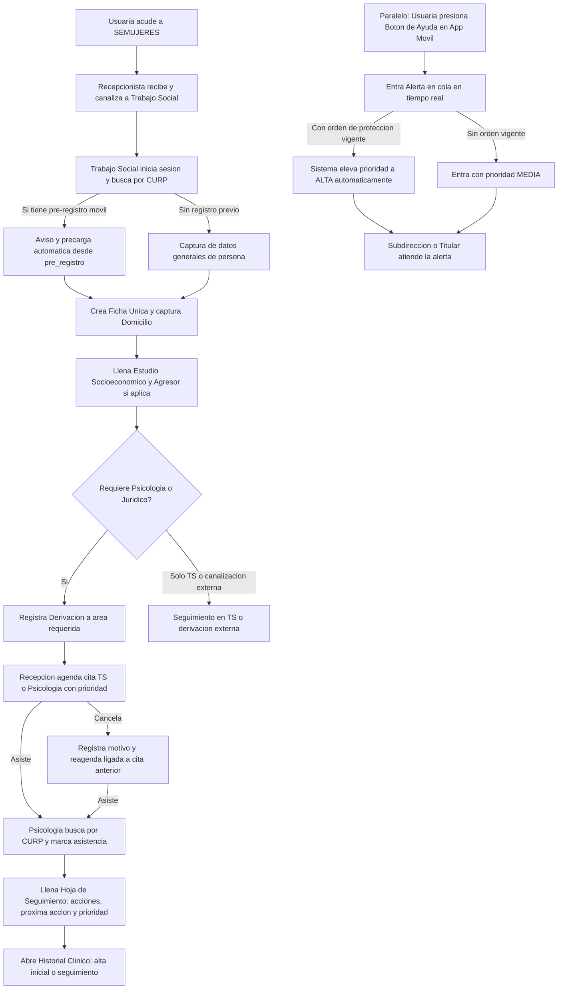

# Flujo Operativo del Sistema — SEMUJERES Ahome

Especificación funcional del recorrido completo de atención en la Secretaría (Web de gestión, App móvil y Base de Datos), alineado con [requerimientos-y-reglas.md](./requerimientos-y-reglas.md), [alcance-mvp.md](./alcance-mvp.md) y [trazabilidad-requerimientos-db.md](./trazabilidad-requerimientos-db.md).

---

## Diagrama general del flujo

---

## Etapas del flujo operativo

### 1. Llegada y Filtro Inicial (Trabajo Social)
1. **Recepción inicial:** la usuaria llega a la Secretaría; la recepcionista la atiende y la canaliza directamente al área de Trabajo Social.
2. **Inicio de sesión:** la Trabajadora Social inicia sesión en la plataforma web con su cuenta (`trabajo_social`).
3. **Búsqueda y detección por CURP (`RF-04`, `RF-34`):** busca a la usuaria por CURP. Si ya tiene expediente, el sistema avisa y evita duplicados; si cuenta con un registro previo desde la app móvil (`pre_registro`), el sistema precarga sus datos generales para confirmarlos y ligarlos al expediente sin duplicar.
4. **Ficha Única y Domicilio (`RF-01`, `RF-02`, `RN-12.1`):** crea la Ficha Única (`ficha_registro`) con folio automático institucional (`SEM-AAAA-NNNN`), registro obligatorio de aceptación del Aviso de Privacidad (`RNF-04`), servicios solicitados (`ficha_servicio_solicitado`) y captura del domicilio estructurado ligado al catálogo SEPOMEX local (`cat_asentamiento` o código postal de respaldo).
5. **Estudio Socioeconómico:** captura ingresos propios, dependientes, apoyos, datos de la vivienda y equipamiento en `estudio_socioeconomico`, junto con otros aportantes del hogar en `aportante_hogar`.
6. **Persona Agresora (`RF-05`):** si aplica, registra los datos de la persona agresora en `agresor` (nombre desglosado, parentesco, domicilio estructurado, ocupación, consumos y uso de armas).
7. **Guardado:** persiste la información del expediente; toda alta y modificación queda registrada automáticamente en `bitacora_acceso` (`RF-22`).

### 2. Toma de Decisión y Canalización (Trabajo Social)
8. **Evaluación de canalización:** al concluir la Ficha Única, Trabajo Social determina si la usuaria requiere atención en Psicología, Jurídico o canalización externa (por ejemplo, si el usuario es hombre y no corresponde a tema jurídico, `RN-03`).
9. **Registro de Derivación (`RF-08`):** si se canaliza a otra área o institución externa, registra una fila en `derivacion` indicando área origen, destino, institución y motivo.

### 3. Gestión de Citas (Recepción)
10. **Acceso de Recepción (`RF-21`, `RN-04`):** cuando la usuaria requiere cita presencial con Psicología o Trabajo Social, Recepción inicia sesión en la plataforma web *(el área Jurídica gestiona su propia agenda de forma directa)*.
11. **Alta de cita (`RF-06`, `RN-01`):** en la Agenda, Recepción selecciona a la usuaria por nombre o CURP, asigna el área (`trabajo_social` o `psicologia`), selecciona la prioridad operativa (`alta`, `media`, `baja`) y establece fecha y hora con estado inicial `'agendada'`. Para citas de Psicología, el sistema valida mayoría de edad (`>= 18` años a partir de la CURP).
12. **Cancelación y reagendado (`RF-06`, `RN-06`):** si la usuaria cancela, Recepción registra `motivo_cancelacion`, marca la cita como `'reagendada'` y crea una nueva cita vinculada a la anterior mediante `reagendada_de` para conservar el historial completo (pudiendo consultar `vista_lista_urgencias` si queda un espacio libre, `RF-07`).

### 4. Atención y Seguimiento (Psicología)
13. **Acceso de Psicología:** la psicóloga inicia sesión en la plataforma web con su rol (`psicologia`).
14. **Consulta de expediente (`RF-03`, `RF-22`):** busca a la usuaria por CURP, nombre o folio y abre su expediente (quedando registrada la consulta en `bitacora_acceso` mediante `registrar_consulta()`).
15. **Asistencia (`RF-06`):** actualiza el estado de la cita correspondiente a `'asistio'` (o `'no_asistio'` si faltó).
16. **Hoja de Seguimiento (`RF-09`, `RN-13`):** registra la atención de la sesión en `atencion` documentando `acciones_realizadas`, `proxima_accion`, copia actualizada de datos generales del día y la `prioridad` clínica del caso (`alta`, `media` o `baja`). Si lo requiere, registra notas confidenciales en `nota_area` (visibles únicamente para Psicología, `RF-10`, `RN-09`).
17. **Historial Clínico (`RF-11`, `RF-12`, `RF-12.1`):** en **Expedientes → Historial clínico**, Psicología (o Dirección) captura los antecedentes, el motivo de consulta, las observaciones iniciales y si hubo atención psicológica previa. Puede escribir o dictar los campos de texto con Whisper local: no dictar CURP ni nombres propios, y revisar la transcripción antes de añadirla al campo. El registro inicial es único por ficha. En visitas posteriores puede leerlo y agregar una observación vinculada a una cita asistida o a una atención sin cita, sin sobrescribir observaciones anteriores. Si ya existe una Hoja de Seguimiento sin observación, se completa esa hoja en lugar de duplicarla.

### 5. Flujo Paralelo de Alertas (App Móvil → Titular / Subdirección)
18. **Emisión desde móvil (`RF-18`, `RF-33`):** en paralelo a la atención presencial, si una usuaria con cuenta en la aplicación móvil activa el Botón de Ayuda (pulsación sostenida de 2 segundos y cuenta regresiva), el sistema inserta una alerta en `alerta` (`origen = 'app_movil'`) visible en tiempo real en la cola web (`RF-20`).
19. **Atención en línea (`RN-16`):** Titular, Subdirección o Jurídico (encargados de línea 24/7) ingresan al módulo de Alertas, toman la alerta `'nueva'` (pasando a `'tomada'` con marca de tiempo) y posteriormente la cierran como `'atendida'`.
20. **Priorización automática por orden de protección (`RF-17`, `RF-18.1`, `RN-17`):** al crearse la alerta, el trigger de servidor (`asignar_prioridad_alerta()`) verifica si la cuenta móvil está ligada por CURP a una `persona` con `orden_proteccion` vigente (`tiene_orden_vigente()`); de ser así, asigna automáticamente prioridad `'alta'` (de lo contrario entra en `'media'`) sin revelar en la app móvil la existencia del expediente u orden.

---

## Actores y entidades involucradas por etapa

| Etapa | Actor responsable | Entidades principales en BD |
|---|---|---|
| **1. Llegada y Filtro Inicial** | Recepción (canaliza) / Trabajo Social (captura) | `pre_registro` (`buscar_pre_registro_por_curp`), `persona`, `domicilio`, `ficha_registro`, `ficha_servicio_solicitado`, `estudio_socioeconomico`, `aportante_hogar`, `agresor`, `bitacora_acceso` |
| **2. Toma de Decisión** | Trabajo Social | `derivacion` |
| **3. Gestión de Citas** | Recepción *(TS y Psicología)* / Jurídico *(directo)* | `persona` (lectura), `cita` (`estado`, `prioridad`, `motivo_cancelacion`, `reagendada_de`), `vista_lista_urgencias` |
| **4. Atención y Seguimiento** | Psicología | `cita`, `atencion`, `historial_clinico`, `nota_area` (privada), `orden_proteccion`, `documento`, `bitacora_acceso` |
| **5. Alertas 24/7** | Usuaria móvil (emite) / Titular, Subdirección, Jurídico (atienden) | `alerta` (`supabase_realtime`), `pre_registro`, `orden_proteccion` (`tiene_orden_vigente`) |
