# Flujos operativos y contratos RPC (Supabase ↔ React TS)

SEMUJERES Ahome · Violet Code · Backend

Este documento toma el **flujo principal** (llegada → decisión → citas → psicología → alertas), lo divide en **subflujos** y, para cada paso, dice **qué RPC o tabla usar**, **qué manda el front** y **qué regresa**. Está basado en el estado actual del repo (rama `develop`, commit `43cd297`), migraciones `01` a `12`.

**Versión 3.** Esta versión está alineada con [`docs/estandar-servicios-y-rpcs.md`](../../docs/estandar-servicios-y-rpcs.md) (sección 9) y contrastada con el documento *Alcance del MVP* (sección 10). La v3 agrega SF-00 (registro en la app), SF-15 (INE y foto), SF-16 (notas privadas) y SF-17 (archivar), que están en el alcance pero no en el flujo principal.

> **Sobre la migración que revierte catálogos y `tipo_arma`:** ya está en el repo como `20261126000100_11_revertir_catalogos_y_tipo_arma.sql` (y la `12` corrige `crear_ficha_completa`). Todo lo de abajo asume que **ya se aplicaron**: `persona.discapacidad`, `persona.religion` y `persona.grupo_etnico` son `text` libre, ya no existen `cat_discapacidad`, `cat_religion`, `cat_grupo_etnico` ni el enum `tipo_arma`; el arma del agresor se describe con `especificacion_arma` (texto libre; la migración `_14_quitar_check_arma` quita además `utilizo_arma_u_objeto` y sus CHECK). La copia en archivos del proyecto (`migraciones/20261126000100_10_...sql`) es una versión anterior de la misma migración (sin el cambio a la RPC): **no la apliquen además de la `11`**, porque usan el mismo timestamp y la segunda fallaría.

Leyenda de estado en las tablas:

- ✅ **Existe**: ya está en migraciones (y en muchos casos ya lo usa el front).
- 🟡 **Ajustar**: existe pero le falta algo para este flujo.
- 🆕 **Propuesta**: no existe; se sugiere crearla.

---

## 0. Mapa general

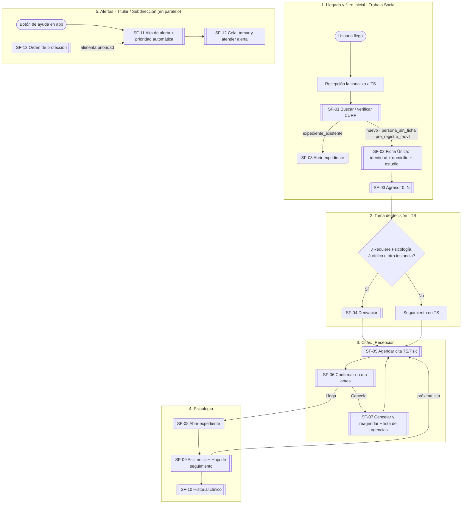

### Subflujos identificados

| ID | Subflujo | Etapa | Rol principal | Estado backend |
|---|---|---|---|---|
| SF-01 | Buscar / verificar CURP con precarga | 1 | TS (también Psic, Rec) | 🆕 `verificar_curp`, `buscar_expedientes` |
| SF-02 | Ficha Única: identidad + domicilio + estudio socioeconómico | 1 | TS | ✅ |
| SF-03 | Persona agresora (0..N) | 1 | TS | ✅ (no atómico con SF-02) |
| SF-04 | Derivación / canalización | 2 | TS | ✅ alta · 🆕 `cambiar_estado_derivacion` |
| SF-05 | Agendar cita | 3 | Recepción | ✅ alta (tabla) · 🆕 `get_agenda` |
| SF-06 | Confirmar citas de mañana | 3 | Recepción | 🆕 `cambiar_estado_cita` |
| SF-07 | Cancelar, reagendar y lista de urgencias | 3 | Recepción | 🆕 `reagendar_cita`, `get_lista_urgencias` |
| SF-08 | Abrir expediente (con bitácora) | 4 | Psic, TS, Jur, Dir | 🆕 `get_expediente_detalle` |
| SF-09 | Asistencia + Hoja de seguimiento | 4 | Psic (y TS, Jur) | 🆕 `registrar_seguimiento` |
| SF-10 | Historial clínico | 4 | Psic | ✅ tabla (upsert) |
| SF-11 | Alta de alerta desde app y prioridad | 5 | App móvil | ✅ trigger |
| SF-12 | Cola de alertas: ver, tomar, atender | 5 | Titular / Subdir / Jur | 🆕 `get_cola_alertas`, `tomar_alerta`, `atender_alerta` |
| SF-13 | Orden de protección (alimenta SF-11) | transversal | TS / Jur | ✅ tabla |
| SF-14 | Línea de tiempo del caso (RF-25) | transversal | todas | 🆕 `get_linea_tiempo` |

---

## 1. Convenciones (según el estándar)

```ts
// Los enums se tipan en cada modelo de dominio (src/domain/models/<Entidad>.ts),
// no en infrastructure. Ejemplo para Cita.ts, Alerta.ts, Seguimiento.ts:
import type { Database } from '@/infrastructure/supabase/database.types';

type Enums = Database['public']['Enums'];
export type PrioridadNivel   = Enums['prioridad_nivel'];    // 'alta' | 'media' | 'baja'
export type EstadoCita       = Enums['estado_cita'];        // 'agendada' | 'confirmada' | 'cancelada' | 'reagendada' | 'asistio' | 'no_asistio'
export type EstadoFicha      = Enums['estado_ficha'];       // 'abierto' | 'en_seguimiento' | 'cerrado' | 'archivado'
export type EstadoAlerta     = Enums['estado_alerta'];      // 'nueva' | 'tomada' | 'atendida'
export type OrigenAlerta     = Enums['origen_alerta'];      // 'app_movil' | 'telefono' | 'presencial'
export type DestinoDerivacion = Enums['destino_derivacion'];// 'trabajo_social' | 'psicologia' | 'juridico' | 'fiscalia' | 'refugio' | 'capacitacion' | 'otra_institucion'
export type EstadoDerivacion = Enums['estado_derivacion'];  // 'pendiente' | 'en_proceso' | 'concluida' | 'cancelada'

/** Únicos códigos que usan las RPC (estándar §3.2). Mensajes siempre en español. */
export const PG_ERROR = {
  SIN_PERMISO: '42501',   // sin auth.uid(), empleado inactivo o rol no autorizado
  DUPLICADO: '23505',     // duplicados y conflictos: CURP con expediente, cita ya reagendada, alerta ya tomada
  REGLA_NEGOCIO: '23514', // datos inválidos o transición no permitida: menor de edad, registro inexistente, estado incorrecto
} as const;
```

### 1.1 Cuándo RPC y cuándo `.from()` (estándar §2)

| Caso | Qué se usa en este documento |
|---|---|
| Alta o edición que toca 2 o más tablas | RPC atómica (`crear_ficha_completa`, `reagendar_cita`, `registrar_seguimiento`) |
| Búsqueda o listado con filtros, joins o paginación | RPC de consulta (`buscar_expedientes`, `verificar_curp`, `get_agenda`, `get_lista_urgencias`, `get_cola_alertas`, `get_linea_tiempo`) |
| Detalle completo de un expediente | RPC `jsonb` (`get_expediente_detalle`) |
| Cambio de estado con reglas de rol o transición | RPC (`cambiar_estado_cita`, `cambiar_estado_derivacion`, `tomar_alerta`, `atender_alerta`) |
| Catálogo o 1 tabla sin joins | `.from()` con **columnas explícitas** y **`.limit(...)`**; nunca `select('*')` |

### 1.2 Plantilla obligatoria de toda RPC nueva (estándar §3.2)

- `language plpgsql`, **`security definer`**, `set search_path = public`. No se usa `security invoker` (la versión 1 lo proponía para dos RPC; ya se corrigió).
- Primer bloque: valida `auth.uid()` y rol activo en `public.empleado` (`42501`). Como la RPC se salta RLS, **repite en su `where` las reglas de RLS de la tabla** (por ejemplo, Recepción solo citas de TS y Psicología).
- Valida reglas de negocio **antes** de escribir (`23514`, `23505`).
- **Alias en todas las tablas** (`c.id`, `f.persona_id`), sobre todo porque casi todas usan `returns table`.
- `revoke execute ... from public, anon;` y `grant execute ... to authenticated;`.

### 1.3 Ficha de contrato

Cada RPC nueva se documenta con los 4 puntos del estándar §4: **nombre**, **actores autorizados**, **entrada** y **salida + errores**.

### 1.4 Capa de servicios en `apps/admin` (estándar §4)

Cada RPC baja por 4 piezas: modelo (`domain/models`) → puerto (`domain/ports`) → adaptador (`infrastructure/supabase/adapters`, mapea `snake_case → camelCase` y propaga el error) → hook (`features/<modulo>/api.ts`, TanStack Query). La sección 8.3 dice qué archivo y qué hook le toca a cada RPC.

### 1.5 Otras reglas

1. Parámetros de RPC en `snake_case` con prefijo `p_`.
2. **Bitácora:** los cambios se registran solos con `registrar_cambio()`. Las lecturas las registra la propia RPC de lectura (`get_expediente_detalle`, `get_cola_alertas`); `registrar_consulta` queda para lecturas que no pasan por una RPC (agresor).
3. Migraciones nuevas: `_13_` y `_14_` ya están tomadas, así que siguen las `_15_` en adelante. Los números exactos por tarea están en el sprint (`supabase/doc-supabase/sprints/sprint-01-supabase.md`). Antes, `git fetch origin` y `npx supabase migration list` para confirmar que nadie tomó ese número.
4. Después: `npx supabase gen types typescript --linked > apps/admin/src/infrastructure/supabase/database.types.ts`.

---

## 2. Etapa 1 · Llegada y filtro inicial (Trabajo Social)

### SF-01 · Buscar / verificar CURP con precarga (RF-03, RF-04, RF-34, RN-02)

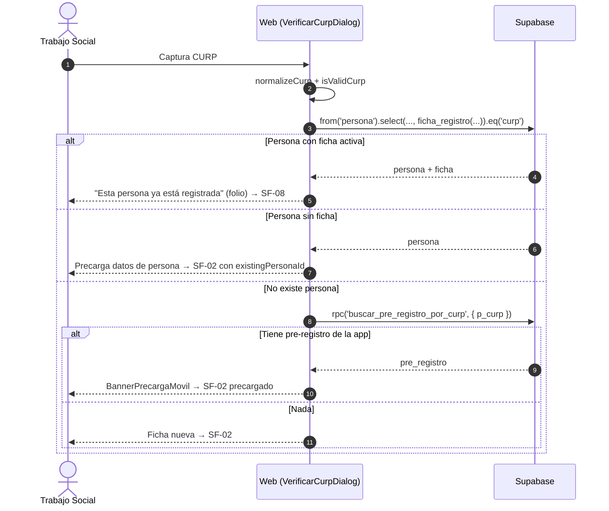

| Paso | Operación | Estado |
|---|---|---|
| Buscar persona + ficha por CURP | hoy: `from('persona').select('…, ficha_registro(…)')` (`SupabaseExpedienteRepository.verifyByCurp`). Es un join REST, y el estándar pide RPC | ✅ funciona · ❌ estándar → 🆕 `verificar_curp` |
| Precarga de la app | `rpc('buscar_pre_registro_por_curp', { p_curp })`, solo `titular`, `subdireccion`, `trabajo_social` | ✅ (queda dentro de `verificar_curp`) |
| Búsqueda libre por nombre/folio en todo el historial | hoy: trae las últimas 200 fichas y filtra en el navegador | 🟡 → 🆕 `buscar_expedientes` |
| Verificación para Recepción | Recepción **no** puede leer `ficha_registro`, así que el embed vuelve vacío y la persona se ve como `persona_sin_ficha` | 🟡 → 🆕 `verificar_curp` |

**Contrato existente**

```ts
// rpc('buscar_pre_registro_por_curp')
export interface BuscarPreRegistroArgs { p_curp: string }
export interface BuscarPreRegistroRow {
  pre_registro_id: string;
  curp: string;
  nombres: string;
  apellido_paterno: string;
  apellido_materno: string | null;
  sexo: 'H' | 'M';
  fecha_nacimiento: string;   // 'YYYY-MM-DD', calculada desde CURP
  entidad_nacimiento: string; // clave de 2 letras
  celular: string | null;
  persona_id: string | null;  // si ya se ligó por CURP
}
// Devuelve 0 o 1 fila.
```

**🆕 `buscar_expedientes(p_termino, p_limite)`**: para RF-03 "en todo el historial" sin bajar 200 filas y filtrar en el cliente. Usa los índices `pg_trgm` que ya existen sobre `persona`.

```ts
export interface BuscarExpedientesArgs {
  p_termino: string;      // CURP, folio (SEM-AAAA-NNNN) o nombre
  p_limite?: number;      // default 20, máx 100
  p_incluir_archivados?: boolean; // default false
}
export interface BuscarExpedientesRow {
  ficha_id: string;
  folio: string;
  estado: EstadoFicha;
  persona_id: string;
  curp: string;
  nombre_completo: string;
  sexo: 'H' | 'M';
  fecha_nacimiento: string;
  en_lista_urgencias: boolean;
  coincidencia: 'curp' | 'folio' | 'nombre';
  similitud: number;      // 0..1 (pg_trgm), para ordenar
}
```

- **Actores:** `titular`, `subdireccion`, `trabajo_social`, `psicologia`, `juridico`.
- **Errores:** `42501` sin permiso · `23514` término vacío o de menos de 3 caracteres.
- Detecta el tipo con regex (CURP de 18, `^SEM-`), y si es nombre usa `similarity()` / `%`. Pagina en la base con `p_limite`.
- **Obligatoria según el estándar §2** (listado con filtros y joins): sustituye el `list()` actual, que trae 200 fichas y filtra en el navegador.

**🆕 `verificar_curp(p_curp)`**: una sola llamada para el diálogo, y que también le sirva a Recepción sin darle acceso a la ficha.

```ts
export interface VerificarCurpArgs { p_curp: string }
export type VerificarCurpRow =
  | { resultado: 'expediente_existente'; persona_id: string; ficha_id: string; folio: string; estado: EstadoFicha; nombre_completo: string }
  | { resultado: 'persona_sin_ficha';   persona_id: string; ficha_id: null; folio: null; estado: null; nombre_completo: string }
  | { resultado: 'pre_registro_movil';  persona_id: null; ficha_id: null; folio: null; estado: null; nombre_completo: string; pre_registro_id: string }
  | { resultado: 'nuevo';               persona_id: null; ficha_id: null; folio: null; estado: null; nombre_completo: null };
```

- **Actores:** `titular`, `subdireccion`, `trabajo_social`, `psicologia`, `juridico`, `recepcion`.
- Para `recepcion` devuelve solo `resultado`, `persona_id`, `folio` y `nombre_completo` (y nunca `pre_registro_movil`: se reporta como `nuevo`). `pre_registro_movil` solo sale para los roles que hoy pueden llamar `buscar_pre_registro_por_curp`.
- **Errores:** `42501` sin permiso · `23514` CURP con formato inválido.
- **Obligatoria según el estándar §2:** hoy `verifyByCurp` hace un join REST (`persona` + `ficha_registro`) y luego una segunda llamada a la RPC de pre-registro. `verificar_curp` lo junta en 1 sola ida y absorbe a `buscar_pre_registro_por_curp` (que puede quedarse para la app o retirarse).

---

### SF-02 · Ficha Única: identidad + domicilio + estudio socioeconómico (RF-01, RF-02, RNF-04)

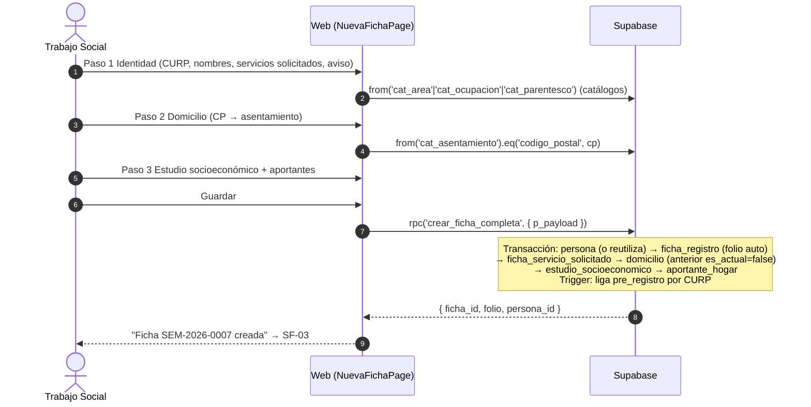

**Contrato existente** (`crear_ficha_completa`, versión de la migración `12`):

```ts
export interface CrearFichaCompletaArgs { p_payload: CrearFichaPayload }

export interface CrearFichaPayload {
  identidad: {
    existingPersonaId?: string | null;   // si SF-01 devolvió persona_sin_ficha
    curp: string;                        // sexo, fecha_nacimiento y entidad salen de aquí (columnas GENERATED)
    nombres: string;
    apellidoPaterno: string;
    apellidoMaterno?: string;
    celular?: string;                    // 10 dígitos
    escolaridad?: EscolaridadNivel | '';
    discapacidad?: string;               // texto libre (migración 11)
    grupoEtnico?: string;                // texto libre (migración 11)
    religion?: string;                   // texto libre (migración 11)
    estadoCivil?: EstadoCivil | '';
    ocupacionId?: number | null;
    ocupacionOtra?: string;
    tieneTrabajo?: boolean;
    numeroHijas?: string;                // se castea a smallint
    numeroHijosHombres?: string;
    servicioMedico?: ServicioMedico | '';
    servicioMedicoOtro?: string;         // solo si servicioMedico = 'otro'
    tieneEmbarazo?: boolean;
    tieneDenuncia?: boolean;
    esVictimaDelito?: boolean;
    serviciosSolicitadosAreaIds: number[]; // obligatorio, al menos 1 (cat_area.id)
    avisoPrivacidadAceptado: true;       // obligatorio
  };
  domicilio: {
    asentamientoId?: number | null;      // de cat_asentamiento (Ahome)
    codigoPostalForaneo?: string;        // solo si asentamientoId es null
    calle?: string;
    numeroExterior?: string;
    numeroInterior?: string;
    referencias?: string;
    zona?: 'urbana' | 'rural' | '';
  };
  estudio: {
    ingresoMensualPropio?: string;
    numeroDependientes?: string;
    tieneApoyo?: boolean;
    especificacionApoyo?: string;
    tipoVivienda?: TipoVivienda | '';
    material?: MaterialVivienda | '';
    materialOtro?: string;
    servicios?: ServicioVivienda[];      // enum[] (migración 10)
    bienes?: BienVivienda[];             // enum[] (migración 10)
    aportantes?: Array<{
      nombre: string;
      parentescoId?: number | null;
      parentescoOtro?: string;
      ocupacionId?: number | null;
      ocupacionOtra?: string;
      tipoTrabajo?: 'fijo' | 'temporal' | 'negocio_propio' | '';
      monto?: string;
      frecuencia?: FrecuenciaIngreso | '';
    }>;
  };
}

export interface CrearFichaCompletaRow { ficha_id: string; folio: string; persona_id: string }

// Errores: 42501 sin permiso · 23514 sin aviso / sin servicio · 23505 CURP ya tiene expediente (incluye folio en el mensaje)
```

Notas para backend:

- **Precarga de la app (RF-34/RF-33):** no hay que mandar `pre_registro_id`. Al insertar `persona`, el trigger `persona_ligar_pre_registro` liga solo el `pre_registro` con la misma CURP y lo pasa a `estado = 'ligado'`. La app nunca se entera.
- **Faltan en el payload** campos de la ficha que ya existen en `ficha_registro`: `tiene_consumo_droga`, `drogas`, `especificacion_droga`, `tiene_consumo_alcohol`. Si el formulario los pide, hay que agregarlos al payload (🟡).
- `tieneTrabajo`, `tieneEmbarazo`, etc. se guardan como `false` si vienen vacíos (`coalesce(..., false)`). Si se quiere distinguir "no contestó", hay que quitar ese `coalesce` (🟡, decisión del equipo).
- ⚠️ La RPC **borra físicamente** una ficha previa de la misma persona si no tiene estudio, atenciones, agresor, órdenes, notas, derivaciones ni documentos. Choca con RF-24/RN-15 ("archivar en lugar de borrar") y el borrado no deja rastro en la bitácora (`registrar_cambio` solo corre en insert/update). Sugerencia: en lugar de borrar, reutilizar esa ficha (update) o desactivarla.

---

### SF-03 · Persona agresora (RF-05)

Se guarda **después** de la ficha (necesita `ficha_id`). Es 0..N.

| Paso | Operación | Estado |
|---|---|---|
| Catálogos | `from('cat_parentesco')`, `from('cat_ocupacion')`, `from('cat_asentamiento')` | ✅ |
| Crear | `from('agresor').insert(row).select(AGRESOR_SELECT).single()` | ✅ (1 tabla) |
| Editar | `from('agresor').update(row).eq('id', id).select(AGRESOR_SELECT).single()` | ✅ (1 tabla) |
| Listar al abrir el expediente | `from('agresor').select(AGRESOR_SELECT).eq('ficha_id', id).eq('activo', true).limit(20)` + `rpc('registrar_consulta', { p_tabla: 'agresor', p_registro_id: fichaId })` | ✅ (columnas explícitas y `limit`, estándar §2) |

`AGRESOR_SELECT` es la constante con columnas explícitas que ya usa `SupabaseAgresorRepository`, así que este punto ya cumple. Agresor es 1 tabla sin joins, así que `.from()` cumple el estándar. Si el detalle del expediente pasa a `get_expediente_detalle` (SF-08), los agresores pueden venir ahí y esta lectura con su `registrar_consulta` se queda solo para recargar después de editar.

```ts
// Insert directo a tabla (RLS: agresor.acceder = dirección + TS + Psic + Jur)
export interface AgresorInsert {
  ficha_id: string;
  nombres: string;                 // obligatorio
  apellido_paterno?: string | null;
  apellido_materno?: string | null;
  edad?: number | null;            // si no se sabe la fecha
  fecha_nacimiento?: string | null;
  entidad_nacimiento?: string | null; // clave de 2 letras
  sexo?: 'H' | 'M' | null;
  estado_civil?: EstadoCivil | null;
  curp?: string | null;
  parentesco_id?: number | null;
  parentesco_otro?: string | null;
  asentamiento_id?: number | null; // excluyente con codigo_postal
  codigo_postal?: string | null;
  calle?: string | null; numero_exterior?: string | null; numero_interior?: string | null;
  referencias?: string | null; zona?: 'urbana' | 'rural' | null;
  ocupacion_id?: number | null; ocupacion_otra?: string | null;
  tipo_trabajo?: 'fijo' | 'temporal' | 'negocio_propio' | null;
  tiene_consumo_droga?: boolean | null;
  drogas?: string[] | null;        // solo si tiene_consumo_droga
  especificacion_droga?: string | null;
  tiene_consumo_alcohol?: boolean | null;
  especificacion_arma?: string | null; // texto libre (migración _14_ quitó tipo_arma, utilizo_arma_u_objeto y sus CHECK)
  observaciones?: string | null;
}
// Devuelve la fila completa de agresor.
```

🟡 **Atomicidad (paso 7 "Guarda la información"):** hoy, si la ficha se crea pero el agresor falla, queda la ficha sin agresor. Dos opciones:

1. **Recomendada para el hackathon:** dejarlo como está (dos pasos) y que la pantalla de agresor reintente sobre el `ficha_id` ya creado. Es lo más simple y ya funciona.
2. Agregar `agresores?: AgresorInput[]` a `p_payload` de `crear_ficha_completa` e insertarlos en la misma transacción.

---

## 3. Etapa 2 · Toma de decisión (Trabajo Social)

### SF-04 · Derivación / canalización (RF-08, RN-03, RN-11)

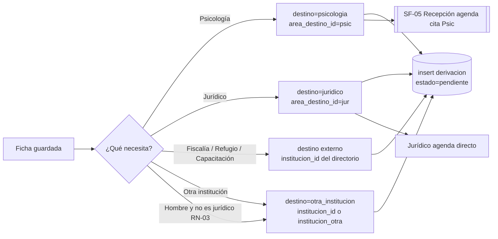

Operación existente: `from('derivacion').insert(...)` (`SupabaseDerivacionRepository.create`).

```ts
export interface DerivacionInsert {
  ficha_id: string;
  area_origen_id: number | null;     // el área de quien deriva (auth_area_id)
  destino: DestinoDerivacion;
  area_destino_id: number | null;    // obligatorio si destino es trabajo_social | psicologia | juridico
  institucion_id: number | null;     // directorio_institucion.id, solo para destinos externos
  institucion_otra: string | null;   // excluyente con institucion_id
  motivo?: string | null;
  fecha_derivacion?: string;         // default current_date
}
// Respuesta: { id: string }
```

El alta es de 1 tabla, así que `.from('derivacion').insert(...).select('id').single()` cumple el estándar. Las reglas (RN-01, `area_origen_id`) se validan en el trigger, como se explica abajo.

**🆕 `cambiar_estado_derivacion`** (estándar §2: "cambio de estado con reglas de rol o transición → RPC"). Hoy `SupabaseDerivacionRepository.updateEstado` hace un `update` directo sin validar la transición.

- **Actores:** `titular`, `subdireccion` (cualquiera); `trabajo_social`, `psicologia`, `juridico` solo si su área es la de origen o la de destino (TS además en todas, igual que `derivacion_select`).
- **Transiciones válidas:** `pendiente → en_proceso | cancelada`, `en_proceso → concluida | cancelada`. Las demás dan `23514`.

```ts
export interface CambiarEstadoDerivacionArgs {
  p_derivacion_id: string;
  p_estado: EstadoDerivacion;
}
export interface CambiarEstadoDerivacionRow { derivacion_id: string; estado: EstadoDerivacion; actualizado_en: string }
// Errores: 42501 sin permiso · 23514 derivación inexistente o transición no permitida
```

🟡 Validaciones que **no** hace hoy la base:

- **RN-01:** derivar a Psicología o Jurídico a una persona menor de 18. Hoy solo truena después, al agendar la cita o registrar la atención. Sugerencia: extender `validar_derivacion_area()` para revisar la edad y fallar desde aquí (errcode `23514`).
- **RN-03:** hombre + destino `psicologia` debería avisarse. Hacerlo como aviso en el front (no bloquear), porque RN-07 abre Psicología a población LGBTQ+.
- **`area_origen_id`:** la política `derivacion_insert` no revisa que sea el área de quien inserta. Sugerencia: llenarlo en un trigger `before insert` con `auth_area_id()` cuando venga nulo.

---

## 4. Etapa 3 · Citas (Recepción)

Reglas: RN-04 (Recepción solo agenda TS y Psicología; Jurídico agenda directo), RN-01 (Psic/Jur solo ≥ 18, ya lo valida el trigger `cita_validar_mayoria_edad`), RN-05 (una vez al mes), RN-06 (confirmar un día antes; si cancela, reagendar y llamar a alguien urgente).

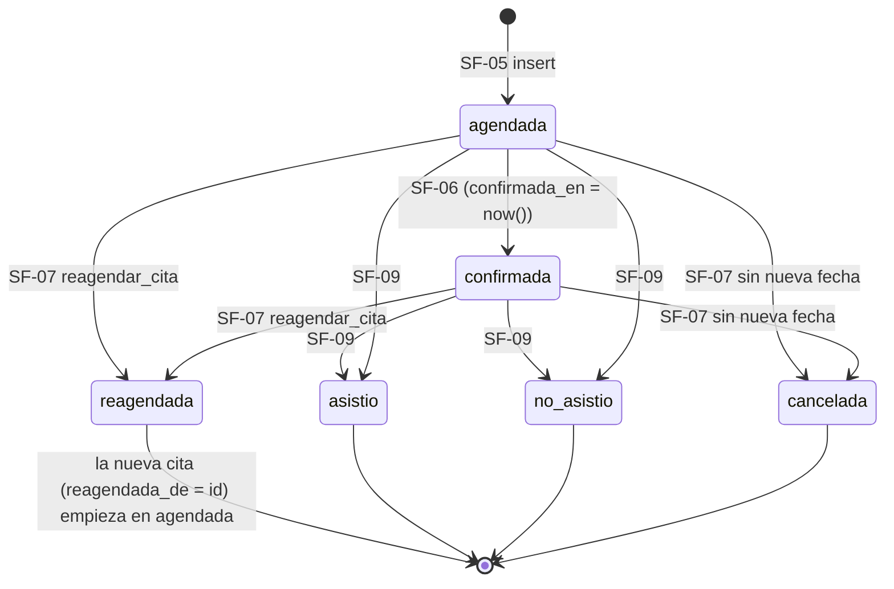

### SF-05 · Agendar cita (RF-06)

Para encontrar a la usuaria, Recepción usa `verificar_curp` (SF-01). Una búsqueda por nombre con `from('persona').or(...)` sería un listado con filtros y el estándar pide RPC.

El alta de la cita es de 1 tabla, así que `.from('cita').insert(...)` cumple el estándar; RLS (`cita_insert`) y el trigger de mayoría de edad ponen las reglas.

```ts
// from('cita').insert(row).select('id, estado, programada_en').single()
// RLS cita_insert: dirección · recepción (solo TS/Psic) · área de atención (solo la suya)
export interface CitaInsert {
  persona_id: string;
  area_id: number;                 // cat_area.id de trabajo_social o psicologia (Recepción)
  programada_en: string;           // ISO con zona: '2026-12-03T10:00:00-07:00' (America/Mazatlan)
  prioridad?: PrioridadNivel | null; // migración 08
  recomendada_por?: string | null; // "quién recomendó" (RF-06)
  origen?: 'regular' | 'umeca';    // default 'regular'
  // estado se omite: default 'agendada'
}
export interface CitaCreada { id: string; estado: 'agendada'; programada_en: string }
// Errores: 23514 menor de edad en Psicología/Jurídico · RLS 42501 si Recepción intenta Jurídico
```

**🆕 `get_agenda`**: listar la agenda lleva join con `persona` y filtros por rango, área y estado, así que según el estándar §2 va por RPC. Hoy `SupabaseDashboardRepository.getAppointments` lo hace con un join REST y hay que migrarlo.

- **Actores:** `titular`, `subdireccion` (todas las áreas); `recepcion` y `trabajo_social` (TS y Psicología); `psicologia` y `juridico` (solo la suya). Son las mismas reglas de `cita_select`, repetidas dentro de la RPC.
- **Errores:** `42501` sin permiso · `23514` rango inválido (`p_hasta <= p_desde` o más de 31 días).

```ts
export interface GetAgendaArgs {
  p_desde: string;                 // ISO con zona
  p_hasta: string;                 // ISO con zona, exclusivo
  p_area_id?: number | null;       // null = todas las que el rol puede ver
  p_estados?: EstadoCita[] | null; // p. ej. ['agendada'] para "por confirmar"
  p_limite?: number;               // default 200
}
export interface AgendaRow {
  cita_id: string;
  programada_en: string;
  estado: EstadoCita;
  prioridad: PrioridadNivel | null;
  area_id: number;
  area_clave: 'trabajo_social' | 'psicologia' | 'juridico';
  recomendada_por: string | null;
  reagendada_de: string | null;
  origen: 'regular' | 'umeca';
  persona_id: string;
  nombre_completo: string;
  celular: string | null;          // para llamar a confirmar
}
```

🟡 Opcional: evitar dos citas activas del mismo día y área para la misma persona (índice único parcial o validación en el front).

### SF-06 · Confirmar citas de mañana (RF-06, RN-06)

Lista "por confirmar": `rpc('get_agenda', { p_desde: mañana 00:00, p_hasta: pasado mañana 00:00, p_estados: ['agendada'] })`.

**🆕 `cambiar_estado_cita`** (estándar §2: cambio de estado con reglas de rol y transición). Sirve para confirmar (SF-06), cancelar sin reagendar (SF-07) y marcar `no_asistio` (SF-09). `asistio` no pasa por aquí: lo pone `registrar_seguimiento`. `reagendada` tampoco: lo pone `reagendar_cita`.

- **Actores:** los mismos de `cita_update` (dirección; recepción solo TS y Psicología; cada área la suya).
- **Transiciones válidas:** `agendada → confirmada | cancelada | no_asistio`, `confirmada → cancelada | no_asistio`. Llena `confirmada_en = now()` al confirmar (lo exige el CHECK).

```ts
export interface CambiarEstadoCitaArgs {
  p_cita_id: string;
  p_estado: 'confirmada' | 'cancelada' | 'no_asistio';
  p_motivo?: string | null;        // solo para 'cancelada' (motivo_cancelacion, opcional)
}
export interface CambiarEstadoCitaRow { cita_id: string; estado: EstadoCita; confirmada_en: string | null }
// Errores: 42501 sin permiso o cita de otra área · 23514 cita inexistente o transición no permitida
```

### SF-07 · Cancelar, reagendar y lista de urgencias (RF-06, RF-07, RN-06)

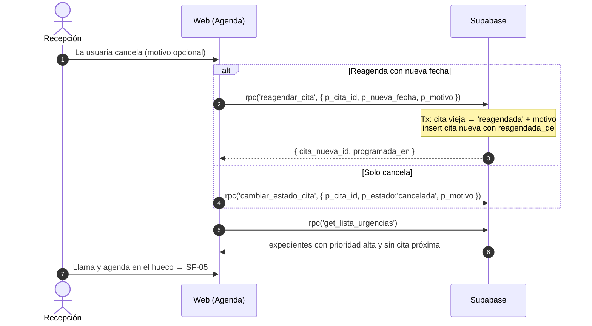

**🆕 `reagendar_cita`** (atómica; hoy serían dos llamadas sueltas y podría quedar la vieja en `reagendada` sin la nueva).

```ts
export interface ReagendarCitaArgs {
  p_cita_id: string;
  p_nueva_fecha: string;       // ISO con zona
  p_motivo?: string | null;    // opcional (RF-06)
  p_prioridad?: PrioridadNivel | null; // si null, copia la de la cita original
}
export interface ReagendarCitaRow {
  cita_anterior_id: string;
  cita_nueva_id: string;
  programada_en: string;
  estado: 'agendada';
}
// Errores: 42501 sin permiso o cita de un área que el rol no maneja
//          23514 cita inexistente, no está en 'agendada'/'confirmada', fecha en el pasado o menor de edad (trigger)
//          23505 la cita ya se había reagendado (reagendada_de es UNIQUE)
```

- **Actores:** los mismos de `cita_update`: `titular`, `subdireccion` (todas); `recepcion` solo citas de TS y Psicología; `trabajo_social`, `psicologia` y `juridico` solo las de su área.
- `security definer` como pide el estándar §3.2 (en la versión 1 proponía `invoker`). Por eso la RPC **repite las reglas de RLS de `cita_update`** en su validación de rol.
- La cita nueva hereda persona, área, origen y `recomendada_por`.

**🆕 `get_lista_urgencias()`**: hoy existe la vista `vista_lista_urgencias` (`security_invoker`), pero **Recepción no ve nada** porque no puede leer `ficha_registro` ni `atencion`, y Psicología solo ve prioridades de su propia área. Como RN-06 dice que Recepción es quien llama, hace falta una RPC `SECURITY DEFINER` que devuelva solo lo necesario para llamar:

```ts
export interface GetListaUrgenciasArgs { p_area_id?: number | null } // filtra por área de la última prioridad
export interface ListaUrgenciasRow {
  persona_id: string;
  ficha_id: string;
  folio: string;
  nombre_completo: string;
  celular: string | null;
  area_ultima_prioridad: string;   // 'psicologia' | 'trabajo_social' | 'juridico'
  fecha_ultima_prioridad: string;  // date
}
// Actores: titular, subdireccion, recepcion, trabajo_social, psicologia. Sin CURP, sin notas.
// Errores: 42501 sin permiso.
```

---

## 5. Etapa 4 · Psicología

### SF-08 · Abrir expediente (RF-03, RF-22, RN-08)

| Paso | Operación | Estado |
|---|---|---|
| Buscar | SF-01 (`verificar_curp` o `buscar_expedientes`) | 🆕 |
| Detalle Ficha Única | hoy: `SupabaseFichaRepository.getDetail` hace 3 llamadas REST (`ficha_registro`, `domicilio`, `estudio_socioeconomico`) y el front llama aparte a `registrar_consulta` | ✅ funciona · ❌ estándar → 🆕 `get_expediente_detalle` |
| Citas de hoy de la persona | vienen dentro de `get_expediente_detalle` | 🆕 |

**🆕 `get_expediente_detalle(p_ficha_id)`**: el estándar §2 dice textualmente "Detalle completo de un expediente → RPC (`jsonb` o `table`)". Reemplaza las 3 llamadas actuales y la de bitácora por una sola.

- **Actores:** `titular`, `subdireccion`, `trabajo_social`, `psicologia`, `juridico` (`expediente.ver`).
- **Bitácora:** inserta `'ver'` en `bitacora_acceso` para `ficha_registro` (y para `agresor` si los incluye) dentro de la misma RPC.
- **Errores:** `42501` sin permiso · `23514` ficha inexistente o inactiva.

```ts
export interface GetExpedienteDetalleArgs {
  p_ficha_id: string;
  p_incluir_agresores?: boolean;   // default false; si true, también registra la consulta de agresor
}
/** jsonb: un solo objeto */
export interface ExpedienteDetalleJson {
  ficha: { id: string; folio: string; estado: EstadoFicha; registrada_en: string; /* resto de columnas de ficha_registro */ };
  persona: { id: string; curp: string; nombres: string; apellido_paterno: string; apellido_materno: string | null;
             sexo: 'H' | 'M'; fecha_nacimiento: string; entidad_nacimiento: string; celular: string | null;
             escolaridad: EscolaridadNivel | null; discapacidad: string | null; religion: string | null; grupo_etnico: string | null };
  servicios_solicitados: Array<{ area_id: number; clave: string; nombre: string }>;
  domicilio_actual: { id: string; asentamiento_id: number | null; asentamiento_nombre: string | null; codigo_postal: string | null;
                      calle: string | null; numero_exterior: string | null; numero_interior: string | null;
                      referencias: string | null; zona: 'urbana' | 'rural' | null } | null;
  estudio_actual: { id: string; /* columnas de estudio_socioeconomico */ aportantes: Array<{ id: string; nombre: string; /* … */ }> } | null;
  orden_vigente: boolean;
  citas_hoy: Array<{ cita_id: string; programada_en: string; estado: EstadoCita; area_clave: string }>; // filtradas por el rol, como cita_select
  agresores?: AgresorRow[];        // solo si p_incluir_agresores
}
```

### SF-09 · Asistencia + Hoja de seguimiento (RF-09, RN-13, RF-07)

La **Hoja de Seguimiento es la tabla `atencion`** (`acciones_realizadas`, `proxima_accion`, `prioridad`, `observaciones`, `cita_id`). La prioridad que se guarda aquí es la que usa la lista de urgencias.

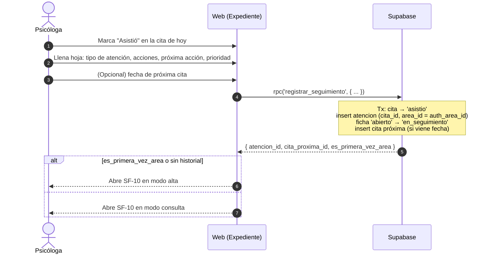

Si faltó: `rpc('cambiar_estado_cita', { p_cita_id, p_estado: 'no_asistio' })` (sin hoja).

**🆕 `registrar_seguimiento`** (hoy no hay nada en el front para esto; con tablas sueltas serían 3 o 4 llamadas).

```ts
export interface RegistrarSeguimientoArgs {
  p_ficha_id: string;
  p_cita_id?: string | null;          // null = atención sin cita (urgencia, presencial)
  p_tipo_atencion_id: number;         // cat_tipo_atencion del área (p. ej. 'terapia_individual')
  p_acciones_realizadas?: string | null;
  p_proxima_accion?: string | null;
  p_prioridad?: PrioridadNivel | null; // RF-07: opcional y editable
  p_observaciones?: string | null;
  p_proxima_cita_en?: string | null;  // RN-05: si viene, crea la siguiente cita en la misma área
}
export interface RegistrarSeguimientoRow {
  atencion_id: string;
  cita_proxima_id: string | null;
  es_primera_vez_area: boolean;       // primera atencion de la persona en esa área (RN-19, informes)
  tiene_historial_clinico: boolean;   // solo relevante para Psicología
}
// Reglas dentro:
// - area_id = auth_area_id() del empleado (no lo manda el front).
// - p_tipo_atencion_id debe pertenecer a esa área (23514).
// - Si p_cita_id: la cita debe ser de la misma persona y área y estar en 'agendada' o 'confirmada'; pasa a 'asistio'.
// - RN-01 la valida el trigger existente (23514).
// Errores: 42501 sin permiso · 23514 ficha o cita inexistente, cita de otra persona/área, estado no válido, menor de edad
//          23505 la cita ya tiene hoja de seguimiento (atencion.cita_id es UNIQUE)
```

- **Actores:** `trabajo_social`, `psicologia`, `juridico` (cada quien en su área). Dirección no, porque no tiene `auth_area_id()`.
- `security definer` como pide el estándar §3.2 (en la versión 1 proponía `invoker`). La RPC valida rol y área explícitamente, en lugar de dejárselo a RLS.

Editar la prioridad después (RF-07 "se puede editar"): `from('atencion').update({ prioridad }).eq('id', atencionId).select('id, prioridad').single()`. Es 1 tabla y no es transición de estado, así que `.from()` cumple.

Catálogo de tipos para el combo: `from('cat_tipo_atencion').select('id, clave, nombre').eq('area_id', miAreaId).limit(50)`.

### SF-10 · Historial clínico (RF-11, RF-12)

`historial_clinico` tiene `ficha_id UNIQUE`: **uno por expediente**. RLS: solo Psicología y Dirección.

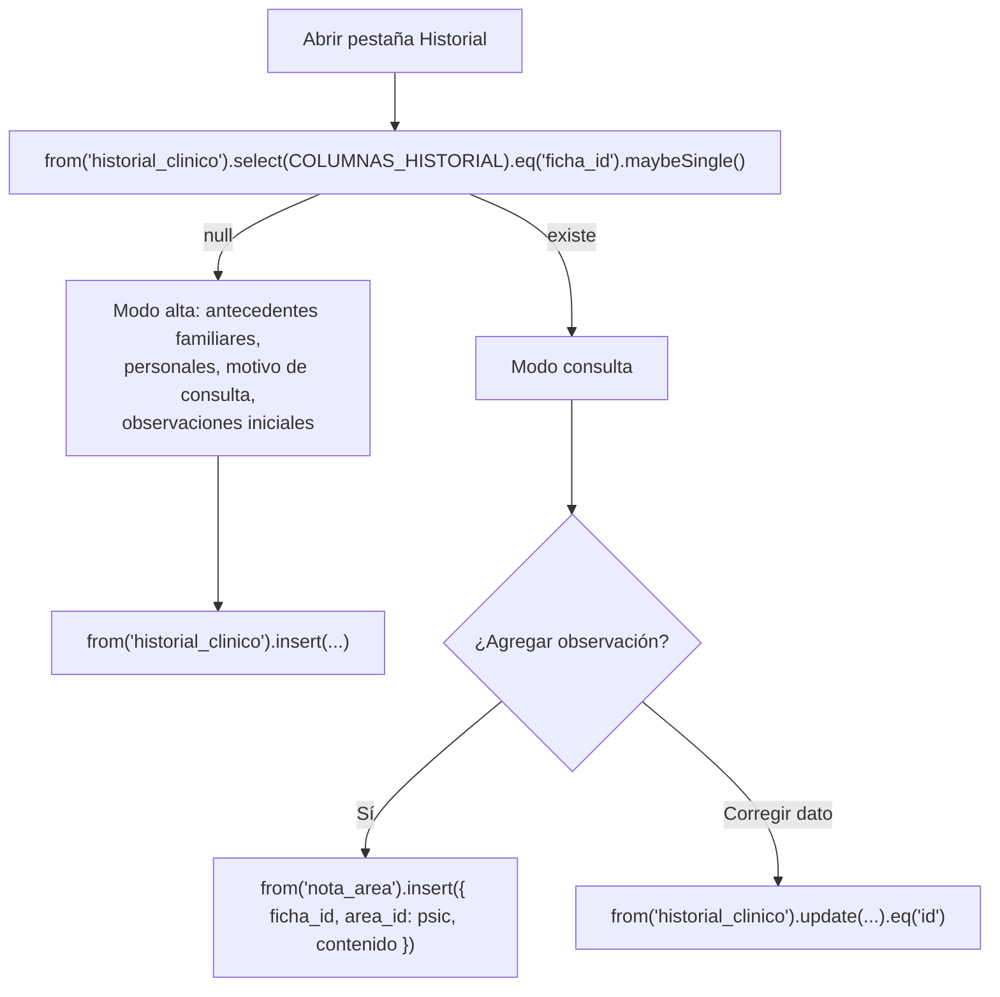

```ts
export interface HistorialClinicoInsert {
  ficha_id: string;
  antecedentes_familiares?: string | null;   // ≤ 5000
  antecedentes_personales?: string | null;
  motivo_consulta?: string | null;
  observaciones_iniciales?: string | null;
  tiene_atencion_psicologica_previa?: boolean | null;
}
// Lectura + bitácora: rpc('registrar_consulta', { p_tabla: 'historial_clinico', p_registro_id: historialId })
```

Todo el historial es 1 tabla sin joins, así que `.from()` con columnas explícitas (`COLUMNAS_HISTORIAL`) cumple el estándar. `maybeSingle()` ya limita a 1 fila. Si quieren ahorrar la llamada de bitácora, se puede agregar `historial_clinico` a `get_expediente_detalle` solo cuando el rol es Psicología o Dirección.

Decisión de modelo: "si ya tiene historial, solo revisa o agrega observaciones". La tabla solo tiene `observaciones_iniciales`. Para las observaciones posteriores recomiendo **reusar `nota_area` con el área de Psicología**: ya es privada por área (RF-10, RN-09) y tiene fecha y autor. Así no hace falta tabla nueva. Lo que se anota en cada sesión va en `atencion.observaciones` (SF-09).

> Ojo: Dirección **sí** ve `historial_clinico` pero **no** ve `nota_area`. Si las observaciones clínicas deben ser visibles para Dirección, entonces convendría una tabla `historial_clinico_observacion` en lugar de `nota_area`.

RF-12 (dictado por voz) solo llena los mismos campos en el front; no cambia el contrato.

---

## 6. Etapa 5 · Alertas (Titular / Subdirección)

### SF-11 · Alta de alerta desde la app (RF-18, RF-20, RN-17)

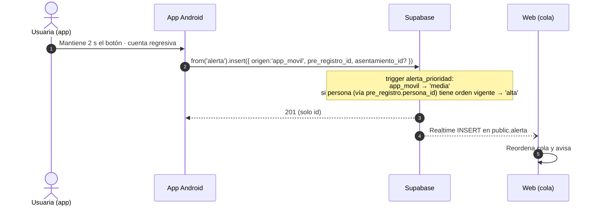

```ts
// App móvil (RLS alerta_insert: origen = 'app_movil', persona_id null, pre_registro propio y activo)
export interface AlertaInsertMovil {
  origen: 'app_movil';
  pre_registro_id: string;
  asentamiento_id?: number | null;
  // NO mandar prioridad: el trigger la sobrescribe.
}

// Web, línea 24/7 (RF-32: "SI ALCANZA" en el alcance; no es parte del MVP base)
export interface AlertaInsertWeb {
  origen: 'telefono' | 'presencial';
  persona_id?: string | null;      // excluyente con pre_registro_id
  prioridad?: PrioridadNivel;      // default 'media'; si tiene orden vigente, el trigger la sube a 'alta'
  asentamiento_id?: number | null;
  observaciones?: string | null;
}
```

Ya funciona en la base. Dos huecos 🟡:

1. La prioridad se calcula **solo al insertar**. Si la orden de protección se registra después (SF-13), las alertas `nueva` de esa persona se quedan en `media`. Sugerencia: trigger `after insert or update on orden_proteccion` que suba a `alta` las alertas `nueva` de esa persona.
2. El front no puede verificar por sí mismo si hay orden vigente (`tiene_orden_vigente` tiene `revoke execute`), y Jurídico/Psicología no pueden leer `pre_registro`, así que una alerta de la app sin `persona_id` no se puede ligar a un nombre desde el cliente. Lo resuelve la propuesta 6.

### SF-12 · Cola de alertas: ver, tomar, atender (RF-20, RN-16)

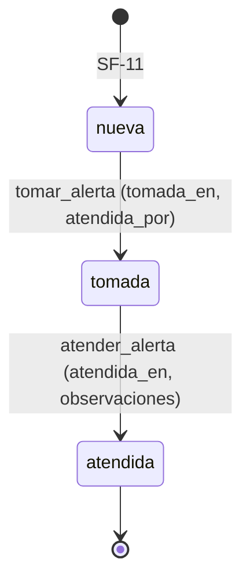

**🆕 `get_cola_alertas(p_estados)`**: la cola ya ordenada, con los datos que la Subdirección necesita para revisar el paso 3 del flujo ("revisa que, si tiene orden vigente, haya subido a alta").

```ts
export interface GetColaAlertasArgs { p_estados?: EstadoAlerta[]; p_limite?: number } // default ['nueva','tomada'], 50
export interface ColaAlertaRow {
  alerta_id: string;
  origen: OrigenAlerta;
  prioridad: PrioridadNivel;
  estado: EstadoAlerta;
  creado_en: string;
  tomada_en: string | null;
  atendida_por_nombre: string | null;
  persona_id: string | null;        // resuelto también vía pre_registro.persona_id
  ficha_id: string | null;
  folio: string | null;
  nombre_completo: string | null;   // de persona o de pre_registro
  celular: string | null;
  tiene_orden_vigente: boolean;     // para el paso 3
  asentamiento_nombre: string | null;
}
// Orden: prioridad (alta→baja, el enum está declarado 'alta','media','baja'), luego creado_en asc.
// Registra 'ver' en bitácora.
// Errores: 42501 sin permiso · 23514 p_limite fuera de 1..200
```

- **Actores:** `titular`, `subdireccion`, `juridico`, `trabajo_social`, `psicologia` (`alerta.ver_cola`).
- **Obligatoria según el estándar §2** (listado con joins y orden). En la versión 1 dejaba como alternativa un `from('alerta').select('…, persona:persona_id(…)')`. Ya no se ofrece, y la consulta que usa hoy `SupabaseDashboardRepository.getAlerts` también tendría que migrar a esta RPC.

Tiempo real (ya habilitado en la publicación `supabase_realtime`). La suscripción solo avisa; los datos se vuelven a pedir con la RPC invalidando la `queryKey`:

```ts
supabase.channel('cola-alertas')
  .on('postgres_changes', { event: '*', schema: 'public', table: 'alerta' },
      () => queryClient.invalidateQueries({ queryKey: ['alertas', 'cola'] }))
  .subscribe();
```

**🆕 `tomar_alerta` / `atender_alerta`**: evitan que dos personas tomen la misma alerta y llenan las marcas de tiempo que exige el CHECK.

```ts
export interface TomarAlertaArgs { p_alerta_id: string }
export interface AtenderAlertaArgs { p_alerta_id: string; p_observaciones?: string | null }
export interface AlertaEstadoRow { alerta_id: string; estado: EstadoAlerta; tomada_en: string | null; atendida_en: string | null; atendida_por: string }
// tomar_alerta: update ... set estado='tomada', tomada_en=now(), atendida_por=auth.uid()
//               where id = p_alerta_id and estado = 'nueva' → si 0 filas: 23505 "ya la tomó alguien"
// atender_alerta: solo si estado='tomada'; set estado='atendida', atendida_en=now(), observaciones
// Errores: 42501 sin permiso · 23514 alerta inexistente o en estado que no corresponde · 23505 ya la tomó otra persona
```

- **Actores:** `titular`, `subdireccion`, `juridico` (`alerta.atender`, línea 24/7).

### SF-13 · Orden de protección (RF-17) — alimenta la prioridad

```ts
// from('orden_proteccion').insert(row).select('id, estado, fecha_vigencia').single()
// 1 tabla: .from() cumple el estándar. RLS escribir: dirección, jurídico, trabajo social
export interface OrdenProteccionInsert {
  ficha_id: string;
  agresor_id?: string | null;       // debe ser de la misma ficha (FK compuesta)
  numero_oficio?: string | null;
  autoridad_emisora?: string | null;
  fecha_emision: string;            // date
  fecha_vigencia?: string | null;   // ≥ fecha_emision; null = sin vencimiento
  estado?: 'vigente' | 'vencida' | 'cancelada' | 'en_tramite'; // default 'vigente'
}
```

---

## 7. Transversal · Línea de tiempo del caso (RF-25)

**🆕 `get_linea_tiempo(p_ficha_id)`**. Con tablas sueltas, cada rol vería solo pedazos (Psicología no ve atenciones de TS ni citas de Jurídico). RF-25 pide la línea "según el rol", sin notas.

```ts
export interface LineaTiempoRow {
  fecha: string;                    // timestamptz
  tipo: 'registro' | 'cita' | 'atencion' | 'derivacion' | 'orden_proteccion' | 'alerta';
  area: string | null;
  titulo: string;                   // p. ej. "Cita Psicología · asistió"
  detalle: string | null;           // sin contenido clínico ni notas: solo estado/tipo
  referencia_id: string;
}
// Dirección: todo. Áreas: eventos de todas las áreas pero solo título/estado;
// el detalle (acciones_realizadas, observaciones) solo de su área.
// Errores: 42501 sin permiso · 23514 ficha inexistente
```

- **Actores:** `titular`, `subdireccion`, `trabajo_social`, `psicologia`, `juridico`.

---

## 7b. Subflujos del alcance que no aparecen en el flujo principal

### SF-00 · Registro en la app (RF-33) · Móvil

Es el paso previo a "si viene de la app, precarga sus datos" (SF-01). Lo hace la app Android, no la web.

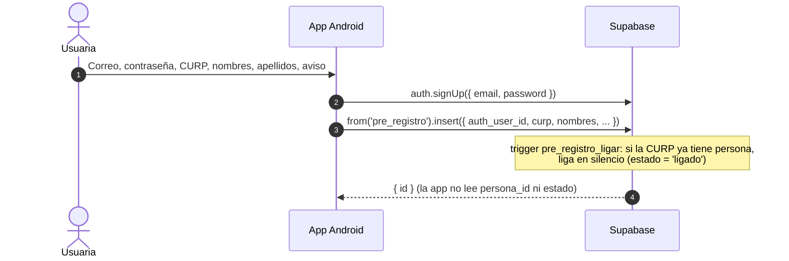

```ts
// 1 tabla: .from() cumple el estándar. RLS: auth_user_id = auth.uid()
export interface PreRegistroInsert {
  auth_user_id: string;            // = auth.uid() de la sesión recién creada
  curp: string;                    // sexo, fecha de nacimiento y entidad salen de la CURP (GENERATED)
  nombres: string;
  apellido_paterno: string;
  apellido_materno?: string | null;
  celular?: string | null;
  aviso_privacidad_aceptado_en: string;
}
// La app debe pedir solo .select('id') para no leer persona_id ni estado (RF-33: no revelar si había expediente).
// Hoy la política pre_registro_select sí le deja leer su propia fila completa, incluidos persona_id y estado.
// Sugerencia: una vista o RPC para la app que no exponga esas dos columnas.
```

### SF-15 · INE y foto en la Ficha Única (RF-35)

Ya existe (`SupabaseDocumentoStorageRepository.subir`): sube a Storage (bucket privado `documentos`, ruta `<ficha_id>/<uuid>-<archivo>`) y luego inserta en `documento`.

```ts
// Paso 1: supabase.storage.from('documentos').upload(ruta, file)   (≤ 10 MB, jpg/png/pdf)
// Paso 2: from('documento').insert(row).select(...).single()
export interface DocumentoInsert {
  ficha_id: string;
  tipo_documento_id: number;       // cat_tipo_documento (INE, fotografía, …)
  orden_proteccion_id?: string | null;
  descripcion?: string | null;
  ruta_storage: string;
  nombre_archivo: string;
}
// Ver: storage.createSignedUrl(ruta, segundos). Archivar: update documento set activo = false.
```

- Storage y tabla no pueden ir en una sola transacción, así que no hay RPC posible; el estándar no aplica aquí.
- 🟡 Si falla el insert, el adaptador intenta borrar el archivo con `storage.remove()`. Pero en `07_rls.sql` no hay política `delete` sobre `storage.objects` para el bucket `documentos`, así que ese borrado de respaldo falla en silencio y queda un archivo huérfano. Habría que agregar esa política, o dejar el archivo y limpiarlo después.

### SF-16 · Notas privadas por área (RF-10, RN-09)

```ts
// 1 tabla: .from() cumple. RLS: solo el área dueña (Dirección NO las ve).
from('nota_area').select('id, contenido, creado_en, creado_por').eq('ficha_id', fichaId).eq('activo', true).order('creado_en', { ascending: false }).limit(50);
from('nota_area').insert({ ficha_id, area_id: miAreaId, contenido }).select('id, creado_en').single();
// contenido: 1..5000 caracteres. area_id debe ser auth_area_id() o RLS lo rechaza.
```

### SF-17 · Archivar en lugar de borrar (RF-24)

Hoy `SupabaseFichaRepository.archive` hace `update({ estado: 'archivado' })` directo. Por el estándar §2 (cambio de estado con reglas) va por RPC:

**🆕 `archivar_ficha(p_ficha_id, p_motivo)`**
- **Actores:** `titular`, `subdireccion`, `trabajo_social` (`expediente.escribir`).
- **Reglas:** solo desde `abierto`, `en_seguimiento` o `cerrado`; no se puede archivar con citas futuras `agendada`/`confirmada` ni con alertas `nueva`/`tomada` (`23514`).
- **Salida:** `{ ficha_id, estado: 'archivado', actualizado_en }`. **Errores:** `42501`, `23514`.
- `deactivate` (`activo = false`) debería quedar solo para Dirección, o quitarse de la UI: RF-24 pide archivar, no dar de baja.

### Otros módulos del alcance que no son parte de este flujo

| Módulo (alcance) | Estado en la base | Nota |
|---|---|---|
| Actividades preventivas (RF-16, MVP) | Tablas `actividad_preventiva` y `actividad_empleado` con RLS | Es otro flujo (no pasa por la usuaria). Falta su propio modelado; alta de 2 tablas → RPC `registrar_actividad_preventiva` |
| Informes mensual y anual (RF-13, MVP) | Vistas `vista_informe_mensual` / `vista_informe_anual` sin PII | Lectura de vista agregada; si se filtra por año y área, envolverla en RPC `get_informe(p_anio, p_mes, p_area_id)` |
| Siete roles con pantalla de inicio (RF-21, MVP) | `empleado.rol` + `usuario_externo` (UMECA) | Ya existe en `navigation.ts` |
| Bitácora (RF-22, MVP) | `bitacora_acceso` + triggers | Lectura para Dirección: hoy join REST en `getRecentActivity` → RPC |
| Mapa de calor (RF-15, **fuera del MVP**) | Ya existe `get_mapa_calor_asentamiento` | Sobra para el MVP; se puede dejar sin pantalla |

---

## 8. Resumen de lo que hay que construir

### Lo que ya existe y se reutiliza

| Recurso | Para qué |
|---|---|
| `crear_ficha_completa(p_payload)` | SF-02 |
| `buscar_pre_registro_por_curp(p_curp)` | SF-01 precarga |
| `registrar_consulta(p_tabla, p_registro_id)` | SF-08, SF-03, SF-10 |
| `get_umeca_citas()` | Rol UMECA |
| Triggers `persona_ligar_pre_registro`, `pre_registro_ligar` | RF-33/34 sin RPC |
| Trigger `alerta_prioridad` | SF-11 |
| Triggers `validar_mayoria_edad_area`, `validar_atencion_coherencia`, `validar_derivacion_area` | RN-01 y coherencia |
| `vista_lista_urgencias`, `vista_informe_mensual/anual` | Urgencias (Dir/TS), informes |
| Tablas con RLS: `agresor`, `derivacion`, `cita`, `historial_clinico`, `nota_area`, `orden_proteccion`, `alerta` | Operaciones de una sola tabla |

### 8.1 RPC nuevas (en orden de prioridad para la demo)

Todas son `security definer` con la plantilla del estándar §3.2. Van repartidas en una migración por tarea del sprint (`_15_` a `_24_`) para que dos devs trabajen en paralelo; ver `supabase/doc-supabase/sprints/sprint-01-supabase.md`.

| Prioridad | RPC | Subflujo | Regla del estándar que la exige |
|---|---|---|---|
| 1 | `registrar_seguimiento` | SF-09 | Escribe en 2 o más tablas (cita, atencion, ficha, cita nueva) |
| 2 | `cambiar_estado_cita` | SF-06, SF-07, SF-09 | Cambio de estado con transición y rol |
| 3 | `reagendar_cita` | SF-07 | Escribe 2 filas y hace una transición |
| 4 | `get_agenda` | SF-05, SF-06 | Listado con join y filtros |
| 5 | `get_lista_urgencias` | SF-07 | Listado con joins (y Recepción hoy no la ve) |
| 6 | `get_cola_alertas` | SF-12 | Listado con joins y orden |
| 7 | `tomar_alerta` / `atender_alerta` | SF-12 | Cambio de estado con transición y rol |
| 8 | `verificar_curp` | SF-01 | Búsqueda con join (hoy REST + 2ª llamada) |
| 9 | `buscar_expedientes` | SF-01 | Búsqueda con filtros sin filtrar en el navegador |
| 10 | `get_expediente_detalle` | SF-08 | Detalle completo de expediente |
| 11 | `cambiar_estado_derivacion` | SF-04 | Cambio de estado con transición y rol |
| 12 | `get_linea_tiempo` | RF-25 | Listado con joins de varias tablas. **Ojo:** RF-25 está en el MVP según el alcance, así que es la última por orden pero no es opcional |
| 13 | `archivar_ficha` | SF-17 | Cambio de estado con reglas (RF-24, MVP) |

### 8.2 Ajustes a lo existente (🟡)

1. `crear_ficha_completa`: no borrar fichas previas (RF-24); agregar campos de consumo si el formulario los pide.
2. `validar_derivacion_area`: validar RN-01 al derivar; llenar `area_origen_id` con `auth_area_id()`.
3. Trigger en `orden_proteccion` para subir a `alta` las alertas `nueva` de la persona.
4. No aplicar la copia `migraciones/…_10_revertir…sql` de los archivos del proyecto: ya está en el repo como `_11_`.

### 8.3 Capa de servicios por RPC (estándar §4)

| RPC | Modelo (`domain/models`) | Puerto (`domain/ports`) · método | Adaptador | Hook (`features/…/api.ts`) · `queryKey` |
|---|---|---|---|---|
| `verificar_curp` | `PreRegistroMovil.ts` (ya tiene `VerificacionCurpResult`) | `ExpedienteRepository.verifyByCurp` | `SupabaseExpedienteRepository` (cambiar implementación) | `expedientes/useVerifyCurp` (mutación, ya existe) |
| `buscar_expedientes` | `Persona.ts` (`ExpedienteResumen`) | `ExpedienteRepository.list(query)` | `SupabaseExpedienteRepository` (cambiar implementación) | `expedientes/useExpedientes` · `['expedientes','list',q]` (ya existe) |
| `get_expediente_detalle` | `FichaRegistro.ts` (`FichaCompletaDetalle`) | `FichaRepository.getDetail` | `SupabaseFichaRepository` (cambiar implementación) | `expedientes/useFichaDetail` · `['expedientes','detail',id]` (ya existe) |
| `cambiar_estado_derivacion` | `Derivacion.ts` (+ `validarTransicionDerivacion`) | `DerivacionRepository.updateEstado` | `SupabaseDerivacionRepository` (cambiar implementación) | `canalizaciones/useUpdateEstadoDerivacion` (ya existe) |
| `get_agenda`, `cambiar_estado_cita`, `reagendar_cita`, `get_lista_urgencias` | 🆕 `Cita.ts` | 🆕 `CitaRepository`: `listarAgenda`, `crear`, `cambiarEstado`, `reagendar`, `listarUrgencias` | 🆕 `SupabaseCitaRepository` | 🆕 `agenda/api.ts`: `useAgenda` · `['agenda', desde, hasta, area]`; `useCrearCita`, `useCambiarEstadoCita`, `useReagendarCita` (invalidan `['agenda']` y `['agenda','urgencias']`); `useListaUrgencias` · `['agenda','urgencias']` |
| `registrar_seguimiento` | 🆕 `Seguimiento.ts` (`validateSeguimiento`) | 🆕 `SeguimientoRepository.registrar` | 🆕 `SupabaseSeguimientoRepository` | 🆕 `expedientes/useRegistrarSeguimiento` (invalida `['expedientes','detail',fichaId]`, `['agenda']` y `['linea-tiempo',fichaId]`) |
| historial (`.from`) | 🆕 `HistorialClinico.ts` | 🆕 `HistorialClinicoRepository`: `obtener`, `crear`, `actualizar` | 🆕 `SupabaseHistorialClinicoRepository` | 🆕 `expedientes/useHistorialClinico` · `['historial', fichaId]` |
| `get_cola_alertas`, `tomar_alerta`, `atender_alerta` | 🆕 `Alerta.ts` (hoy los tipos viven en `Dashboard.ts`) | 🆕 `AlertaRepository`: `listarCola`, `tomar`, `atender` | 🆕 `SupabaseAlertaRepository` | 🆕 `solicitudes/api.ts`: `useColaAlertas` · `['alertas','cola',estados]`; `useTomarAlerta`, `useAtenderAlerta` (invalidan `['alertas','cola']`) |
| `get_linea_tiempo` | 🆕 `LineaTiempo.ts` | 🆕 `LineaTiempoRepository.obtener` | 🆕 `SupabaseLineaTiempoRepository` | 🆕 `expedientes/useLineaTiempo` · `['linea-tiempo', fichaId]` |

Invalidaciones puntuales, sin invalidar listas globales de más (estándar §4.4): por ejemplo, `useTomarAlerta` solo invalida `['alertas','cola']` y no `['expedientes']`.

### 8.4 Matriz rápida rol × RPC nueva

| RPC | titular/subdir | trabajo_social | psicologia | juridico | recepcion |
|---|---|---|---|---|---|
| `verificar_curp` | ✓ | ✓ | ✓ | ✓ | ✓ (reducido) |
| `buscar_expedientes` | ✓ | ✓ | ✓ | ✓ | — |
| `get_expediente_detalle` | ✓ | ✓ | ✓ | ✓ | — |
| `cambiar_estado_derivacion` | ✓ | ✓ | ✓ (origen/destino) | ✓ (origen/destino) | — |
| `get_agenda` | ✓ | ✓ (TS/Psic) | ✓ (Psic) | ✓ (Jur) | ✓ (TS/Psic) |
| `cambiar_estado_cita` / `reagendar_cita` | ✓ | ✓ (TS) | ✓ (Psic) | ✓ (Jur) | ✓ (TS/Psic) |
| `get_lista_urgencias` | ✓ | ✓ | ✓ | — | ✓ |
| `registrar_seguimiento` | — | ✓ | ✓ | ✓ | — |
| `get_cola_alertas` | ✓ | ✓ | ✓ | ✓ | — |
| `tomar_alerta` / `atender_alerta` | ✓ | — | — | ✓ | — |
| `get_linea_tiempo` | ✓ | ✓ | ✓ | ✓ | — |
| `archivar_ficha` | ✓ | ✓ | — | — | — |

---

## 9. Contraste con `docs/estandar-servicios-y-rpcs.md`

### 9.1 Lo que no cumplía la versión 1 de este documento (ya corregido)

| # | Regla del estándar | Qué decía la v1 | Qué dice ahora |
|---|---|---|---|
| 1 | §3.2: toda RPC `security definer` con validación explícita de rol | `reagendar_cita` y `registrar_seguimiento` como `security invoker`, delegando en RLS | `security definer`, y la RPC repite las reglas de RLS de `cita`/`atencion` |
| 2 | §2: cambio de estado con reglas → RPC | Confirmar, cancelar y `no_asistio` con `from('cita').update(...)`; derivación con `update({ estado })` | `cambiar_estado_cita` y `cambiar_estado_derivacion` |
| 3 | §2: listado con joins/filtros → RPC | Agenda y cola de alertas con join REST (`persona:persona_id(...)`) | `get_agenda` y `get_cola_alertas`; se quitó la alternativa con tabla |
| 4 | §2: búsqueda sin filtrar en el navegador | `buscar_expedientes` y `verificar_curp` como opcionales | Obligatorias |
| 5 | §2: detalle de expediente → RPC | Se reutilizaba `getDetail` (3 llamadas REST) + `registrar_consulta` aparte | `get_expediente_detalle` (jsonb, bitácora dentro) |
| 6 | §2: prohibido `select('*')`, siempre `.limit()` | `from('agresor').select('*')` y `from('historial_clinico').select('*')` | Columnas explícitas (`COLUMNAS_*`) y `limit` |
| 7 | §3.2: solo `42501`, `23514`, `23505` | Se inventaba `P0002` para "no encontrado" | "No encontrado" usa `23514` con mensaje en español |
| 8 | §4: los 4 puntos del contrato (nombre, actores, entrada, salida + errores) | Varias RPC sin actores o sin errores | Cada RPC nueva los trae |
| 9 | §4: modelo → puerto → adaptador → hook | Solo había contratos de RPC | Sección 8.3 con archivo, método, hook y `queryKey` |
| 10 | §4.1: enums tipados en `domain/models` | Proponía `infrastructure/supabase/rpc.types.ts` | Enums en cada modelo de dominio |
| 11 | §3.1: numeración de migraciones | No decía número | Una migración por tarea, `_15_` a `_24_` (ver sprint 01) |

### 9.2 Lo que no cumple hoy el código existente (no lo modifiqué)

| Archivo | Regla | Problema |
|---|---|---|
| `SupabaseExpedienteRepository.list` | §2 búsqueda con filtros → RPC | Trae 200 fichas con join a `persona` y filtra en el navegador (`matchesSearch`) |
| `SupabaseExpedienteRepository.verifyByCurp` | §2 | Join REST `persona` + `ficha_registro`, y luego una 2ª llamada a la RPC de pre-registro; para Recepción da un resultado equivocado |
| `SupabaseFichaRepository.getDetail` | §2 detalle → RPC | 3 llamadas REST (`ficha_registro`, `domicilio`, `estudio_socioeconomico`) |
| `SupabaseDerivacionRepository.updateEstado` | §2 cambio de estado → RPC | `update` directo sin validar la transición |
| `SupabaseDerivacionRepository.list` / `listByFicha` | §2 listado con joins → RPC | `DERIVACION_SELECT` hace join REST con `ficha_registro`, `persona`, `cat_area` (×2) y `directorio_institucion`. Tiene columnas explícitas y `limit(200)`, pero por los joins debería ser una RPC (`get_derivaciones`) |
| `SupabaseDashboardRepository.getAlerts` / `getAppointments` / `getCasesToReview` / `getRecentActivity` | §2 listado con joins → RPC | Join REST con `persona`, `cat_area`, `empleado` o `usuario_externo`. Se resuelven con `get_cola_alertas`, `get_agenda` y, para casos y bitácora, dos RPC de consulta más |
| `SupabaseDashboardRepository.getCasesSummary` | §2 | `from('ficha_registro')` + `vista_lista_urgencias` con `limit(300)` para contar en el navegador; mejor un conteo en la base |
| `crear_ficha_completa` (migración 12) | §3.2 validar antes de escribir; RF-24 | Borra físicamente una ficha "vacía" sin rastro en la bitácora |
| `registrar_consulta` (migración 03) | §3.2 | Lanza "Sin permiso" sin `errcode = '42501'`, así que el front no lo puede distinguir de otros errores |
| `SupabaseAgresorRepository`, `buscar_pre_registro_por_curp`, `crear_ficha_completa` (validación de rol) | — | Cumplen: columnas explícitas, `security definer`, rol validado y `revoke`/`grant` |

---

## 10. Contraste con el documento *Alcance del MVP*

Compara tres cosas: el **alcance** (docx), el **flujo principal + requisitos** que se pegaron en el hilo, y este documento.

### 10.1 Contradicciones que hay que resolver con el equipo

| # | Tema | Alcance dice | Requisitos / flujo dicen | Impacto |
|---|---|---|---|---|
| 1 | **Recepción como usuaria de la web** | "Web de gestión para titular, subdirección, trabajo social, psicología y jurídico" (5 roles, sin recepción ni UMECA). Más abajo dice "Siete roles" (RF-21) | RF-21: siete roles, incluida "recepcionista (pura agenda)". La etapa 3 del flujo la hace Recepción | Si Recepción no entra al sistema, la etapa 3 entera (SF-05 a SF-07) la tendría que hacer TS o Psicología. La base y este documento asumen que Recepción sí entra. **Hay que corregir la lista del alcance** |
| 2 | **Direcciones de refugios en la app** | "Orientación y directorio fijos, direcciones de refugios (RF-30)" | RF-30: "**sin** direcciones de refugios" | La base **prohíbe** guardar dirección de un refugio (`CHECK` en `directorio_institucion`). Casi seguro el alcance perdió la palabra "sin"; si no, hay que cambiar la base. Es tema de seguridad de las usuarias |
| 3 | Agenda de Jurídico | Solo "Citas de Trabajo Social y Psicología" | RF-21: "jurídico (con su propia agenda)"; RN-04: "jurídico agenda directo" | La base ya permite que Jurídico agende la suya. Si el alcance la deja fuera, solo es no hacer la pantalla |
| 4 | Botón de ayuda en web | Solo en "MVP: Móvil" | RF-18: "Móvil y web" | En web solo tendría sentido como la alerta por teléfono/presencial (RF-32), que es "si alcanza" |

### 10.2 Cómo queda este documento frente al alcance

| Alcance (MVP web) | RF | Subflujo aquí | Estado |
|---|---|---|---|
| Ficha Única con folio automático | RF-01, RF-02 | SF-02 | ✅ |
| INE y foto como archivos | RF-35 | SF-15 (nuevo en v3) | ✅ existe · 🟡 falta política `delete` en Storage |
| Búsqueda por CURP, nombre o folio + duplicados | RF-03, RF-04 | SF-01 | 🆕 `buscar_expedientes`, `verificar_curp` |
| Persona agresora | RF-05 | SF-03 | ✅ |
| Archivado en lugar de borrar | RF-24 | SF-17 (nuevo en v3) | 🆕 `archivar_ficha` · 🟡 `crear_ficha_completa` borra físicamente |
| Datos sintéticos reproducibles | RNF-01 | — | Existe `supabase/seed.sql`; las RPC nuevas necesitarán datos de citas, atenciones y alertas en el seed |
| Citas TS y Psic, mañana por confirmar | RF-06 | SF-05, SF-06 | 🆕 `get_agenda`, `cambiar_estado_cita` |
| Lista de urgencias | RF-07 | SF-07 | 🆕 `get_lista_urgencias` |
| Seguimiento por cita | RF-09 | SF-09 | 🆕 `registrar_seguimiento` |
| Línea de tiempo del caso | RF-25 | SF-14 | 🆕 `get_linea_tiempo` (MVP, no opcional) |
| Notas privadas por área | RF-10 | SF-16 (nuevo en v3) | ✅ tabla |
| Canalizar a la instancia requerida | RF-08 | SF-04 | ✅ · 🆕 `cambiar_estado_derivacion` |
| Actividades preventivas | RF-16 | Fuera de este flujo (7b) | ⚠️ falta modelarlo |
| Historial clínico + dictado | RF-11, RF-12 | SF-10 | ✅ tabla |
| Siete roles con su inicio | RF-21 | Matriz 8.4 | ✅ (ver contradicción 1) |
| Bitácora | RF-22 | Transversal | ✅ triggers · lecturas por RPC |
| Cola de alertas por prioridad y origen | RF-20 | SF-11, SF-12 | ✅ trigger · 🆕 `get_cola_alertas`, `tomar_alerta`, `atender_alerta` |
| Órdenes de protección | RF-17 | SF-13 | ✅ tabla · 🟡 recalcular prioridad de alertas ya abiertas |
| Informes mensual y anual | RF-13 | Fuera de este flujo (7b) | ✅ vistas |
| Registro en la app y liga por CURP | RF-33, RF-34 | SF-00 (nuevo en v3), SF-01, SF-02 | ✅ triggers · 🟡 la app puede leer `persona_id`/`estado` de su `pre_registro` |

### 10.3 Lo que este documento tenía y el alcance pone como "si alcanza" o fuera

| Elemento | Dónde estaba | Alcance | Cambio |
|---|---|---|---|
| Alerta por teléfono o presencial (`AlertaInsertWeb`) | SF-11 | Si alcanza (RF-32) | Marcado como "si alcanza" |
| `get_mapa_calor_asentamiento` (ya en la base) | — | Fuera (RF-15) | Se deja sin pantalla |
| Confirmación de citas un día antes | SF-06 | MVP (RF-06), y "recordatorios automáticos" fuera | Queda manual: Recepción llama con la lista de `get_agenda`. No hay notificaciones automáticas |
| RN-10 "código 100" | Mencionado en requisitos | Fuera (consulta de alertas para la policía) | No se modela |

### 10.4 Recomendación

Antes de escribir las migraciones del sprint, confirmar con el equipo las contradicciones 1 y 2 de la tabla 10.1. La 1 decide si existen `get_agenda`, `cambiar_estado_cita` y `reagendar_cita` para Recepción. La 2 es un tema de seguridad: la base hoy hace lo que dicen los requisitos ("sin direcciones de refugios").
